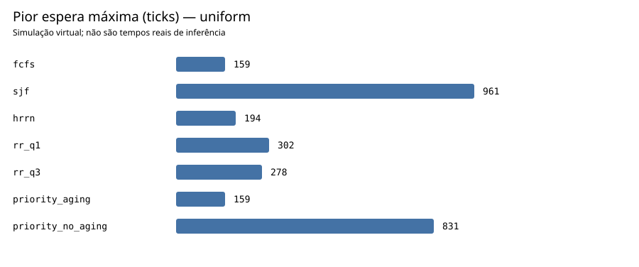

# LLM-Sched: simulador de SO para um servidor do Jev

Relatório final da disciplina de Sistemas Operacionais (CHK3, novembro de 2026). Guia de uso: [docs/USAGE.md](docs/USAGE.md). Documentação completa: [docs/README.md](docs/README.md).

## 1. Introdução e objetivos

O LLM-Sched é um simulador em C11 de um servidor que atende requisições do Jev, o modelo de decisão da TypeSafe AI. Cada requisição é tratada como um processo: tem um bloco de controle (PCB), passa por estados, disputa workers e páginas de memória e é escolhida por uma política de escalonamento. O programa não executa nem consulta o Jev.

A proposta original previa um servidor de LLM generativo, em que o SJF precisaria prever o tamanho da resposta. O Jev devolve uma resposta curta e de tamanho praticamente fixo (categoria, nota ou probabilidade). O custo de uma requisição passa a ser o tamanho da **entrada**, conhecido na chegada, e o preditor deixou de ser necessário. A decisão está na [ADR 0002](docs/adr/0002-foco-typesafe-jev.md).

Os objetivos são:

1. comparar políticas de escalonamento sobre a mesma carga, medindo espera, resposta e starvation;
2. simular memória paginada com FIFO e LRU e o bloqueio por falta de página;
3. demonstrar condição de corrida, deadlock, IPC e sinais com recursos reais do Linux;
4. oferecer um painel visual e experimentos que possam ser repetidos.

## 2. Modelo e arquitetura

**1 tick virtual = 1 token de entrada processado.** Cada worker processa um token por tick. Um PCB passa por NEW, READY, RUNNING, BLOCKED e TERMINATED.

O núcleo é determinístico e não cria threads: a mesma entrada gera sempre o mesmo trace. A cada tick, a sessão acorda quem terminou o I/O, admite as chegadas, escolhe um PCB para cada worker livre, acessa a página do token atual e conclui um token por worker. Uma falta com latência bloqueia o PCB e libera o worker. O que usa threads ou processos fica em bibliotecas e programas separados. Os módulos estão em [docs/ARCHITECTURE.md](docs/ARCHITECTURE.md).

O painel web roda localmente: um servidor em Python (biblioteca padrão) chama a CLI por subprocesso e devolve o JSON exportado; o JavaScript apenas exibe os resultados, o Gantt e o replay.

## 3. Políticas implementadas

| Política | Regra | Preemptiva |
| --- | --- | --- |
| FCFS | Ordem de chegada | Não |
| SJF | Menor entrada | Não |
| RR | Fila circular com quantum em tokens | Sim |
| Prioridade com aging | Maior prioridade; +1 a cada `--aging-interval` ticks de espera (0 desativa) | Não |
| HRRN | Maior razão (espera + tamanho) / tamanho | Não |

O HRRN é a adição do CHK3. A razão é comparada por multiplicação cruzada inteira em 96 bits, sem ponto flutuante e sem overflow. Os empates seguem a ordem da fila e, depois, o ID. Na prática, um pedido curto começa na frente, mas a razão do longo cresce com a espera até ele ser escolhido.

## 4. Metodologia

São 11 cargas. Dez têm 200 requisições, com entradas de 1 a 32 tokens e prioridades de 0 a 5, geradas com as seeds 1 a 5 em duas distribuições de chegada: `uniform` e `burst` (duas ondas). Elas rodam com 2 workers. A 11ª é o cenário de starvation, com 1 worker: um pedido longo (40 tokens) em t=0, quatro curtos (4 tokens) no mesmo instante e mais um a cada 4 ticks, 200 no total.

Todas as políticas recebem a mesma carga e o mesmo limite de starvation (320 ticks, dez vezes o maior pedido gerado). O aging usa intervalo 2. No experimento de memória, o escalonador é FCFS, cada página tem 4 tokens e cada falta custa 5 ticks de bloqueio.

| Experimento | O que mede |
| --- | --- |
| E1 | Corrida entre duas threads, com e sem proteção |
| E2 | FCFS, SJF, HRRN, RR (q=1 e q=3) e prioridade com e sem aging |
| E3 | FIFO e LRU com 2, 4, 8 e 16 frames |
| E4 | Deadlock com mutexes em ordem cruzada e prevenção por ordem global |

Para refazer tudo: `tools/experiments/chk3.sh build /tmp/chk3` (cerca de 30 segundos). As tabelas abaixo vêm de [results/chk3](results/chk3/SUMMARY.md). Médias, p95 e máximo são médias das cinco seeds; "pior máx." é o maior valor entre elas e "starvation" é a soma das requisições que esperaram 320 ticks ou mais.

## 5. Resultados e discussão

### 5.1 Escalonamento (E2)

**Carga uniform**

| Política | Espera média | p95 | Pior máx. | Turnaround | Throughput | Utilização | Starvation |
| --- | --- | --- | --- | --- | --- | --- | --- |
| FCFS | 56,3 | 105,4 | 159 | 72,6 | 0,1187 | 96,8% | 0 |
| SJF | 34,0 | 147,6 | 961 | 50,3 | 0,1186 | 96,7% | 23 |
| HRRN | 44,6 | 110,6 | 194 | 60,9 | 0,1187 | 96,8% | 0 |
| RR q=1 | 80,8 | 206,6 | 302 | 97,1 | 0,1190 | 97,0% | 0 |
| RR q=3 | 78,7 | 197,2 | 278 | 95,0 | 0,1190 | 97,0% | 0 |
| Prioridade com aging | 56,6 | 107,8 | 159 | 72,9 | 0,1188 | 96,8% | 0 |
| Prioridade sem aging | 59,1 | 329,6 | 831 | 75,4 | 0,1189 | 96,9% | 50 |

**Carga burst**

| Política | Espera média | p95 | Pior máx. | Turnaround | Throughput | Utilização |
| --- | --- | --- | --- | --- | --- | --- |
| FCFS | 308,9 | 625,0 | 761 | 325,4 | 0,0898 | 73,9% |
| SJF | 195,4 | 659,6 | 911 | 211,9 | 0,0895 | 73,8% |
| HRRN | 211,3 | 614,4 | 810 | 227,8 | 0,0896 | 73,8% |
| RR q=1 | 427,8 | 740,2 | 881 | 444,3 | 0,0899 | 74,0% |
| RR q=3 | 421,4 | 732,8 | 882 | 437,9 | 0,0898 | 74,0% |
| Prioridade com aging | 309,1 | 624,8 | 772 | 325,6 | 0,0896 | 73,8% |
| Prioridade sem aging | 307,6 | 720,6 | 837 | 324,1 | 0,0897 | 73,9% |



**SJF tem a menor média e a pior espera.** Ele teve a menor espera média nas dez cargas geradas. No cenário de starvation, empata com a prioridade sem aging (15,8). O custo aparece nos longos: na uniform, a pior espera do SJF (961 ticks) é cerca de cinco vezes a do HRRN (194), e 23 requisições passam de 320 ticks.

**HRRN fica entre os dois extremos.** Na uniform, reduz a espera média em 21% em relação ao FCFS (56,3 para 44,6) sem nenhum caso de starvation. Na burst, a redução é de 32% (308,9 para 211,3). O HRRN teve média menor que o FCFS e máximo menor que o SJF nas cinco seeds de cada distribuição. Na burst, também tem o menor p95 médio (614,4), embora a diferença para a prioridade com aging (624,8) e o FCFS (625,0) seja pequena e ele seja o menor em três das cinco seeds.

**Starvation e aging.** No cenário de starvation:

| Política | Espera do pedido longo | Espera média | Espera máxima |
| --- | --- | --- | --- |
| FCFS | 16 | 50,9 | 52 |
| SJF | 796 | 15,8 | 796 |
| HRRN | 120 | 46,2 | 120 |
| RR q=1 | 532 | 68,3 | 532 |
| RR q=3 | 377 | 73,8 | 377 |
| Prioridade com aging | 16 | 50,9 | 52 |
| Prioridade sem aging | 796 | 15,8 | 796 |

No SJF e na prioridade sem aging, o longo só executa depois dos 199 curtos. O HRRN o atende no tick 120; em troca, a espera média sobe de 15,8 para 46,2. Na uniform, o aging reduz a pior espera de 831 para 159 ticks e elimina os 50 casos de starvation. Com intervalo 2, porém, ele quase anula a prioridade: a diferença entre as prioridades é de no máximo 5, coberta por 10 ticks de espera, e a média (56,6) fica próxima da do FCFS (56,3).

**RR troca espera por resposta.** Na uniform, a resposta média cai de 56,3 ticks (FCFS) para 4,4 com q=1 e 12,8 com q=3, mas a espera média sobe cerca de 40% (43% e 40%). O throughput e a utilização quase não mudam: as políticas mudam quem espera, não o trabalho total.

### 5.2 Memória, corrida e deadlock (E3, E1 e E4)

**E3: média das cinco cargas uniform**

| Frames | Faltas FIFO | Faltas LRU | Turnaround FIFO | Turnaround LRU |
| --- | --- | --- | --- | --- |
| 2 | 2875,6 | 1770,0 | 438,1 | 294,5 |
| 4 | 1728,4 | 1667,2 | 314,7 | 294,5 |
| 8 | 939,8 | 984,2 | 295,1 | 294,5 |
| 16 | 895,6 | 905,8 | 294,5 | 294,5 |

Com 2 frames, o LRU tem 38% menos faltas e 33% menos turnaround que o FIFO. Com 8 frames, o FIFO tem um pouco menos faltas (939,8 contra 984,2), mas o turnaround praticamente empata. Com LRU, aumentar os frames não reduziu o turnaround. Na burst o padrão é o mesmo, com ganho de turnaround menor (15% com 2 frames). No cenário de starvation, FIFO e LRU empatam em todas as capacidades.

**E1 e E4**, com 11 execuções de cada modo e o mesmo resultado em todas:

| Laboratório | Modo | Resultado |
| --- | --- | --- |
| Corrida | protegido | 2 de 2 incrementos, nenhum perdido |
| Corrida | sem proteção | 1 de 2 incrementos, um perdido |
| Deadlock | ordem global | concluído, sem deadlock |
| Deadlock | ordem cruzada | deadlock observado e encerrado pelo watchdog |

### 5.3 Limitações

- **Tempo virtual.** Os ticks não medem a latência real do Jev. O custo proporcional à entrada é uma simplificação e as cargas são sintéticas, com cinco seeds por distribuição e sem teste estatístico.
- **Memória.** A latência é cobrada uma vez por falta atendida. Se a página é removida durante o I/O, a recarga conta como falta, mas não bloqueia de novo; por isso o bloqueio total com LRU é constante (4437 ticks na uniform). Não há fixação de frames, e OPT existe só no replay offline, fora do E3.
- **Starvation.** A métrica usa a espera acumulada na fila. No RR, ela não significa que o pedido deixou de executar. Na burst, 467 das 1000 requisições passam do limite até no FCFS, então a comparação ali deve usar a média e o p95.
- **Laboratórios.** Corrida e deadlock usam duas threads e uma intercalação forçada: mostram o fenômeno, não a sua frequência. Eles rodam fora do motor, e não há detecção de deadlock no runtime principal.
- **IPC, pthreads e painel.** O IPC por pipe é uma demonstração sem serviço persistente, e o adaptador pthread não está na CLI. O painel executa a simulação até o fim, e o replay não pausa o motor.

## 6. Alcance dos objetivos

| Objetivo da proposta | Situação | Observação |
| --- | --- | --- |
| PCB, estados, gateway e workers | Atingido | Motor determinístico e adaptador pthread com traces iguais |
| FCFS, SJF, RR e prioridade com aging | Atingido | HRRN adicionado além da proposta |
| SJF com preditor de tamanho | Removido | Desnecessário com o Jev ([ADR 0002](docs/adr/0002-foco-typesafe-jev.md)) |
| Mutex, semáforos e condição de corrida | Atingido | Fila com mutex e semáforos; corrida em laboratório |
| Deadlock: detecção e prevenção | Parcial | Grafo didático e laboratório; não integrado ao motor |
| KV cache paginado, FIFO e LRU | Atingido | Com bloqueio por falta e fragmentação interna |
| Substituição ótima (OPT) | Parcial | Só no replay offline; não comparada no E3 |
| IPC e sinal SIGUSR1 | Atingido | Pipes entre processos e dump por sinal, em programas próprios |
| Cargas | Parcial | Gerador com seed; nenhuma carga real foi coletada |
| Métricas e quatro experimentos | Atingido | Reproduzíveis por script |
| Interface gráfica | Atingido | Painel web local |

A suíte tem 70 testes no CTest, executados no CI com gcc, clang e gcc com ASan/UBSan. Ver [docs/TEST_PLAN.md](docs/TEST_PLAN.md).

## 7. Como executar

```bash
cmake -S . -B build -DCMAKE_BUILD_TYPE=Debug
cmake --build build --parallel
ctest --test-dir build --output-on-failure
./build/os_llm_cli --policy hrrn --scenario scenarios/starvation.csv
python3 apps/visual/server.py --cli ./build/os_llm_cli --port 8765
```

Requer Linux, CMake 3.16+, compilador C11 e Python 3. O painel abre em `http://127.0.0.1:8765`. Detalhes em [docs/USAGE.md](docs/USAGE.md) e roteiro da demonstração em [docs/DEMO.md](docs/DEMO.md).

## 8. Conclusão

Os objetivos principais foram atingidos: o simulador compara cinco políticas sobre a mesma carga, modela memória paginada com bloqueio e demonstra concorrência com recursos reais do Linux. Nas cargas medidas, o SJF é a melhor escolha quando só a média importa; o HRRN reduz a média sem starvation e é o melhor equilíbrio entre as políticas não preemptivas testadas; o RR serve quando a primeira resposta importa mais que a espera total. Na memória, o LRU vale a pena quando há poucos frames. Ficaram fora a integração da detecção de deadlock ao motor, o OPT online e cargas reais.
