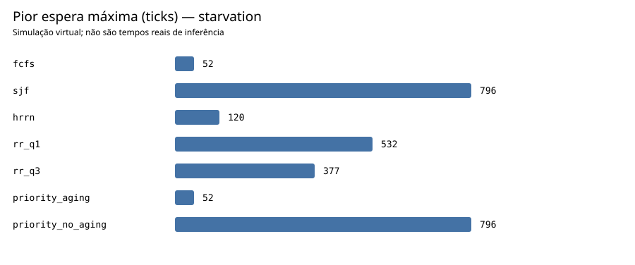

# LLM-Sched: um mini sistema operacional para um servidor do Jev

**Disciplina:** Sistemas Operacionais (UFG) · **Equipe Silicon Guys:** Caio Machado, Eduardo Fraga, Lucas Boclin, Lucas Isaac, Murilo Honorato

## Resumo

O LLM-Sched é um simulador em C11 de um servidor que atende requisições do Jev, modelo de decisão da TypeSafe AI. Cada requisição é um processo com PCB, que disputa *workers* sob uma política de escalonamento e usa um KV cache paginado. Como o Jev devolve uma decisão curta e de tamanho fixo, o custo de um pedido depende só da entrada, conhecida na chegada (**1 tick virtual = 1 token de entrada**). Com isso o SJF fica exato, mas sofre *starvation*. Implementamos o HRRN e o comparamos com FCFS, SJF, Round Robin e prioridade com e sem *aging* em 10 cargas de 200 pedidos e num cenário adversarial. Na carga uniforme, o HRRN reduziu a espera média em 21% frente ao FCFS e eliminou a *starvation* do SJF, com pior espera de 194 ticks contra 961. O projeto inclui ainda *pthreads*, fila com mutex e semáforos, laboratórios de corrida e *deadlock*, IPC por *pipes*, SIGUSR1 e um painel web.

## 1. Introdução

Um servidor de modelos de linguagem recebe muitos pedidos simultâneos de tamanhos diferentes. Ele precisa decidir quem executa primeiro, onde guardar o estado de cada pedido e como coordenar as *threads*. São os problemas clássicos de um SO: escalonamento, memória e concorrência [1].

Sistemas reais de serviço de LLM aplicam essas técnicas. O vLLM guarda o KV cache em blocos de tamanho fixo, inspirado em paginação, para reduzir o desperdício de memória [5]. O Orca escalona por iteração, e não por requisição, para que pedidos curtos não esperem um lote inteiro [6]. SJF e SRTF minimizam a latência média, mas esses sistemas costumam usar FCFS porque o tamanho da resposta de um modelo generativo é desconhecido. Prevê-lo com exatidão é inviável, e Fu et al. preveem só a ordem relativa dos tamanhos [7].

Nossa proposta inicial simulava um LLM generativo e exigia esse preditor para o SJF, o que seria um projeto de aprendizado de máquina à parte. Mudamos o foco para o **Jev**, lançado pela TypeSafe AI em 15/09/2026, que devolve decisões tipadas com probabilidade em vez de texto [8]. A saída é pequena e praticamente fixa, então o custo do pedido é o tamanho da entrada, conhecido na chegada ([ADR 0002](docs/adr/0002-foco-typesafe-jev.md)).

Com o tamanho conhecido, o SJF fica exato e herda seu defeito clássico: um pedido longo pode esperar indefinidamente enquanto chegam pedidos curtos. A solução tradicional é o *aging*, que aumenta a prioridade de quem espera [1]. O HRRN escolhe a maior razão (espera + tamanho)/tamanho, atendendo rápido os curtos sem atrasar demais os longos [2]. Na memória, a substituição ótima (OPT) exige conhecer o futuro [3], e FIFO e LRU a aproximam. Na concorrência, *deadlock* exige as quatro condições de Coffman, e ordenar a aquisição de recursos quebra a espera circular [4].

## 2. Objetivos

1. Modelar pedidos como processos (PCB e cinco estados) e comparar FCFS, SJF, Round Robin e prioridade com *aging*.
2. Simular o KV cache como memória paginada com FIFO e LRU, *page faults* e bloqueio.
3. Executar o trabalho com *threads* POSIX e fila protegida, e demonstrar condição de corrida.
4. Demonstrar, detectar e prevenir *deadlock*.
5. Comunicar processos por *pipe* e tratar SIGUSR1.
6. Oferecer interface gráfica e experimentos reprodutíveis.
7. *(Original, depois substituído)* Prever o tamanho das respostas para o SJF.

## 3. Metodologia

**Modelo e arquitetura.** A simulação é determinística, com relógio virtual. Em cada tick, cada *worker* ocupado processa um token de entrada. O simulador não chama o Jev: mede o efeito das políticas, não latência real. Mesma entrada e configuração produzem o mesmo *trace*, verificado por *replay*. O núcleo em `src/` é dividido em módulos: PCB, admissão, escalonamento, *runtime*, memória, métricas e exportação JSON/CSV. Sobre ele ficam a CLI, o painel web local e os laboratórios POSIX.

**Políticas.** FCFS, SJF (tamanho da entrada), prioridade com *aging* (+1 a cada `--aging-interval` ticks de espera; 0 desativa) e HRRN são não preemptivas. O Round Robin preempta ao fim do *quantum*, em tokens. O HRRN compara razões por multiplicação cruzada inteira de 96 bits, sem ponto flutuante nem *overflow*.

**Memória.** Cada pedido acessa a página `tokens_processados / tokens_por_página`. Uma falta bloqueia o pedido por uma latência configurável e libera o *worker*. As páginas têm tamanho fixo, então só há fragmentação interna. O OPT existe apenas em *replay offline* [3].

**Concorrência, IPC e sinais.** No modo POSIX, *pthreads* reais confirmam cada token por uma fila limitada (mutex e semáforos). Um coordenador único mantém o estado, e o resultado é idêntico ao do modo virtual. Os laboratórios rodam em processos filhos com *watchdog*: corrida forçada por barreira, *deadlock* com dois mutexes, IPC entre *gateway* e motor por *pipes* e SIGUSR1 tratado só com uma *flag*. Um grafo de espera com detecção, prevenção e recuperação de ciclos também está implementado e testado.

**Experimentos** (`tools/experiments/chk3.sh`):

- **E2 (escalonamento):** 10 cargas de 200 pedidos (`uniform` e `burst`, *seeds* 1 a 5, 1 a 32 tokens, prioridade 0 a 5, 2 *workers*). Também o cenário adversarial `scenarios/starvation.csv`: 1 *worker*, um pedido de 40 tokens e um fluxo contínuo de pedidos de 4.
- **E3 (memória):** FIFO e LRU com 2 a 16 *frames* e latência de falta de 5 ticks.
- **E1 e E4 (corrida e *deadlock*):** 11 execuções por modo.

As métricas são espera (média, p95, máxima), resposta, *turnaround*, *throughput*, utilização e *starvation* (pedidos com espera de 320 ticks ou mais). Os valores são médias de 5 *seeds*. O código passa em 70 testes CTest, incluindo um oráculo com frações exatas para o HRRN, e no CI com GCC, Clang e ASan/UBSan.

## 4. Resultados

**HRRN: meio-termo entre eficiência e justiça.** Na carga uniforme (Tabela 1), o SJF tem a menor espera média, mas sua pior espera chega a 961 ticks. O HRRN fica entre FCFS e SJF na média, mantém o pior caso perto do FCFS e não tem nenhum caso de *starvation*. Ele teve média menor que o FCFS e máximo menor que o SJF nas 5 *seeds* das duas distribuições. *Throughput* e utilização (96,7% a 97,0%) quase não mudam: as políticas mudam **quem** espera, não o trabalho total.

*Tabela 1 – E2, carga uniforme (média de 5 seeds; "pior máx." é o maior valor entre elas)*

| Política | Espera média | p95 | Pior máx. | Turnaround | *Starvation* |
| --- | --- | --- | --- | --- | --- |
| FCFS | 56,3 | 105,4 | 159 | 72,6 | 0 |
| SJF | **34,0** | 147,6 | 961 | **50,3** | 23 |
| HRRN | 44,6 | 110,6 | 194 | 60,9 | **0** |
| RR q=1 | 80,8 | 206,6 | 302 | 97,1 | 0 |
| RR q=3 | 78,7 | 197,2 | 278 | 95,0 | 0 |
| Prioridade com *aging* | 56,6 | 107,8 | 159 | 72,9 | 0 |
| Prioridade sem *aging* | 59,1 | 329,6 | 831 | 75,4 | 50 |

**Cenário de *starvation*.** Com um fluxo contínuo de pedidos curtos, o pedido longo espera **796 ticks** no SJF e na prioridade sem *aging*, **120** no HRRN e **16** com *aging* ou FCFS (Figura 1). O SJF continua com a menor espera média (15,8, contra 46,2 do HRRN e 50,9 do FCFS) justamente por adiar o pedido longo.

**Outros resultados.**

- **Round Robin:** troca espera por resposta. O tempo até a primeira execução cai de 56,3 (FCFS) para 4,4 (q=1), mas a espera média sobe cerca de 40%.
- ***Aging*:** elimina os 50 casos de *starvation* da prioridade pura e reduz o pior caso de 831 para 159 ticks. Com prioridades de 0 a 5, porém, intervalo 2 anula a prioridade em 10 ticks, e o resultado fica quase igual ao FCFS.
- **Carga *burst*:** com duas ondas de chegada, todas as políticas pioram e a utilização cai para cerca de 74%. A ordem se mantém: SJF tem a menor média (195,4), e o HRRN (211,3) tem o menor p95 na média das *seeds* (614,4; menor em 3 de 5).
- **Memória (E3):** com 2 *frames*, o LRU bloqueia 38% menos tempo que o FIFO (4437 contra 7206 ticks) e reduz o *turnaround* em 33% (294,5 contra 438,1). A partir de 8 *frames*, as duas políticas empatam.
- **Laboratórios (E1 e E4):** 11 de 11 execuções corretas em cada modo. O modo protegido não perdeu incrementos, o inseguro perdeu um em dois, a ordem global evitou o *deadlock* e a ordem cruzada o produziu (encerrado pelo *watchdog*).

## 5. Discussão

### 5.1 Alcance dos objetivos

| Objetivo | Situação | Evidência |
| --- | --- | --- |
| 1. Escalonamento | **Atingido e ampliado** | Quatro políticas propostas, mais HRRN e `--aging-interval` |
| 2. Memória paginada | **Atingido** | FIFO/LRU online, faltas com bloqueio, fragmentação; OPT só *offline* |
| 3. *Threads* e corrida | **Atingido** | Pool *pthread*, fila com semáforos, resultado idêntico ao virtual, laboratório |
| 4. *Deadlock* | **Parcial** | Grafo com detecção e recuperação testado e laboratório real; fora do motor principal |
| 5. IPC e sinais | **Parcial** | *Pipes* entre dois processos e SIGUSR1 seguro, em demonstrações separadas |
| 6. Interface e experimentos | **Atingido** | Painel web com Gantt e memória; campanha E1 a E4 reprodutível |
| 7. Preditor | **Substituído** | Desnecessário com o Jev ([ADR 0002](docs/adr/0002-foco-typesafe-jev.md)) |

### 5.2 Comparação com a literatura

- **SJF e *starvation* [1, 7].** O SJF teve a menor espera média em todas as cargas (empatado com a prioridade pura no cenário adversarial), como prevê a teoria, e foi, com a prioridade pura, a única política com *starvation* na carga uniforme.
- ***Aging* [1].** Resolveu a *starvation* da prioridade, como esperado. Mostramos também o custo de um intervalo mal calibrado, que reduz a política ao FCFS.
- **HRRN [2].** O resultado bate com a descrição de Ruschitzka: média 21% menor que a do FCFS e pior caso cinco vezes menor que o do SJF, sem parâmetro.
- **Previsão de tamanho [7, 8].** Fu et al. aproximam o SJF prevendo a ordem dos tamanhos. No servidor do Jev, isso é desnecessário: o tipo de modelo servido muda quais algoritmos de SO se aplicam.
- **Granularidade [6].** O RR com *quantum* de 1 token lembra o escalonamento por iteração do Orca e reduziu a resposta de 56,3 para 4,4 ticks. Sem *batching*, porém, aumentou a espera.
- **Memória e *deadlock* [3–5].** As páginas fixas seguem a ideia do vLLM, o OPT só é viável *offline*, como em Belady, e a ordem global preveniu o *deadlock*, como prevê Coffman.

### 5.3 Limitações

- Os ticks são virtuais e as cargas são sintéticas; não há *batching* [6].
- No modelo de memória, a recarga de uma página removida durante o I/O conta como falta, mas não paga latência de novo. Por isso comparamos FIFO e LRU pelo tempo bloqueado, e não pela contagem bruta de faltas.
- Na carga *burst*, o limiar de 320 ticks marca até o FCFS, então ali valem a média e o p95.
- Os laboratórios forçam a intercalação: mostram o fenômeno, não sua frequência. Não houve teste estatístico entre *seeds*.

## 6. Conclusão

Os mecanismos clássicos de SO se aplicam diretamente a um servidor de modelos, e o tipo de modelo muda o problema. Com o Jev, o tamanho do trabalho é conhecido e o SJF fica exato, mas causa *starvation*. O HRRN foi o melhor compromisso: reduziu a espera média frente ao FCFS, eliminou a *starvation* do SJF e não exige calibração. Os demais objetivos foram cumpridos, com integração parcial de *deadlock*, IPC e sinais ao motor principal. Como trabalho futuro, ficam essa integração, *batching* por iteração e cargas medidas com o Jev real.

**Reprodução:** `cmake -S . -B build && cmake --build build && ctest --test-dir build` e depois `tools/experiments/chk3.sh build /tmp/chk3`. Guia de uso: [docs/USAGE.md](docs/USAGE.md). Roteiro da demonstração: [docs/DEMO.md](docs/DEMO.md). Resultados completos: [results/chk3/SUMMARY.md](results/chk3/SUMMARY.md). Índice da documentação: [docs/README.md](docs/README.md).

## Referências

[1] A. Silberschatz, P. B. Galvin e G. Gagne. *Operating System Concepts*, 10ª ed. Wiley, 2018.

[2] M. Ruschitzka. *Performance Evaluation of Nonpreemptive Response-Ratio Schedulers*. Relatório técnico, Rutgers University, 1977. doi:10.7282/t3-fs8v-6d31.

[3] L. A. Belady. A study of replacement algorithms for a virtual-storage computer. *IBM Systems Journal*, 5(2):78–101, 1966. doi:10.1147/sj.52.0078.

[4] E. G. Coffman Jr., M. J. Elphick e A. Shoshani. System Deadlocks. *ACM Computing Surveys*, 3(2):67–78, 1971. doi:10.1145/356586.356588.

[5] W. Kwon et al. Efficient Memory Management for Large Language Model Serving with PagedAttention. *SOSP '23*, 2023. doi:10.1145/3600006.3613165.

[6] G.-I. Yu, J. S. Jeong, G.-W. Kim, S. Kim e B.-G. Chun. Orca: A Distributed Serving System for Transformer-Based Generative Models. *USENIX OSDI '22*, 2022.

[7] Y. Fu, S. Zhu, R. Su, A. Qiao, I. Stoica e H. Zhang. Efficient LLM Scheduling by Learning to Rank. *NeurIPS 2024*. doi:10.52202/079017-1882.

[8] InfoQ. *TypeSafe AI Releases Jev: A Decision-Only Model That Returns Typed Probabilities Instead of Text*, out. 2026. https://infoq.com/news/2026/10/typesafe-ai-jev-released
