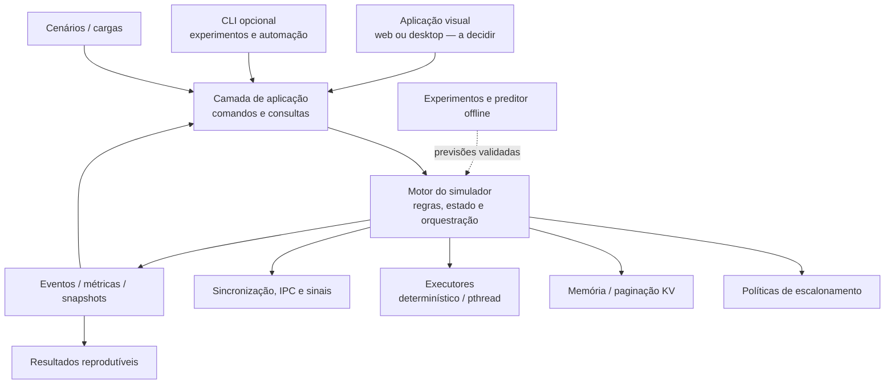

# LLM OS Lab — Plano 01: arquitetura e organização do repositório

> **Estado:** proposta de organização, pronta para orientar a criação de um repositório no GitHub. **Nenhum código foi implementado.**  
> **Data:** 23/10/2026  
> **Origem do escopo:** *LLM-Sched: um mini sistema operacional para servir requisições de LLM*, proposta da disciplina de Sistemas Operacionais.  
> **Repositório:** `OS-llm-project` (privado, criado em `fragaeduardo`).  
> **Decisões deliberadamente pendentes:** C11 ou C++20; interface web ou desktop e seu framework; bibliotecas de teste; protocolo definitivo de comunicação entre interface e motor; pipe ou memória compartilhada POSIX para IPC; política exata para simulação versus concorrência real.

## 1. Objetivo desta etapa

Organizar um **monorepositório acadêmico, modular e colaborativo**, permitindo que cinco estudantes desenvolvam componentes em paralelo. A organização precisa:

1. Cobrir a proposta original: processos/PCB, escalonamento, workers, sincronização, deadlock, paginação/KV cache, IPC/sinais, IA e experimentos.
2. Separar o **motor de simulação** de uma **interface visual gráfica** (web ou desktop a definir), evitando que decisões de UI contaminem algoritmos.
3. Permitir testar algoritmos isoladamente e substituir estratégias sem alterar os outros módulos.
4. Suportar dois mecanismos de execução em estudo: **determinístico (relógio virtual)** e **concorrente (threads POSIX reais)**.
5. Ter repositório simples de entender: uma responsabilidade por módulo, poucos contratos estáveis e nenhuma infraestrutura especulativa.
6. Preservar rastreabilidade do trabalho acadêmico e dos experimentos.

**Fora do escopo agora:** escolher linguagem definitiva, construir o frontend, implementar o simulador, instalar dependências, configurar CI de verdade, abrir PRs ou implementar código.

## 2. Visão arquitetural



**Regra central:** a interface envia comandos ao motor e recebe **snapshots e eventos**. Ela nunca manipula diretamente listas de requisições, memória, mutexes ou threads.

### 2.1. Separar domínio de tecnologia

- **Domínio:** o que é uma requisição, seus estados, quando uma política é escolhida, como funciona uma falta de página, quais métricas são calculadas.
- **Mecanismo de execução:** como o trabalho progride — tempo virtual ou threads reais. A opção não deve redefinir o formato de uma requisição nem o conjunto básico de métricas.
- **Adaptação de entrada/saída:** interface, CLI, arquivo de cenário, exportação, sinais e IPC. Esses elementos não tomam decisões de escalonamento.
- **Ferramentas auxiliares:** coleta de tamanhos de prompt/resposta com LLM, treinamento de preditor, gráficos e análises. Não são dependência para abrir o simulador básico.

## 3. Estrutura-alvo do GitHub

A árvore abaixo representa **unidades de responsabilidade**, não a obrigação de criar todas as pastas vazias no primeiro commit. Os nomes finais de arquivos-fonte e extensões serão definidos com a linguagem.

```text
llm-os-lab/
├── README.md                    # visão do projeto, escopo e estado atual
├── CONTRIBUTING.md              # contribuição, branches, revisão e testes
├── LICENSE                      # tipo de licença a escolher em grupo
├── .gitignore                   # build, ambientes, datasets e resultados locais
├── .editorconfig                # estilo básico independente de linguagem
│
├── .github/
│   ├── ISSUE_TEMPLATE/         # propostas de feature, bug e experimento
│   ├── PULL_REQUEST_TEMPLATE.md
│   ├── CODEOWNERS               # opcional após responsabilidades acordadas
│   └── workflows/              # CI de build + testes, após escolha da stack
│
├── docs/
│   ├── ARCHITECTURE.md          # visão, dependências e responsabilidades
│   ├── FUNCTIONAL_SPEC.md       # especificação de funcionalidades
│   ├── CONTRACTS.md             # operações, eventos, estados e erros
│   ├── UI_SPEC.md               # tarefas, telas, componentes e fluxos de UX
│   ├── TEST_PLAN.md             # invariantes e critérios de aceite
│   ├── EXPERIMENTS.md           # protocolo experimental e métricas
│   ├── GLOSSARY.md              # PCB, worker, token, frame, tempo simulado etc.
│   └── adr/                    # decisões técnicas quando efetivamente tomadas
│
├── src/
│   ├── app/                    # composição e coordenação dos casos de uso
│   ├── core/                   # requisições/PCB, estados, relógio lógico
│   ├── gateway/                # entrada, validação e admissão de pedidos
│   ├── scheduling/             # FCFS, SJF, Round Robin, prioridade + aging
│   ├── runtime/                # adaptadores de execução: virtual ou pthread
│   ├── memory/                 # blocos KV, tabelas e substituição FIFO/LRU/OPT
│   ├── concurrency/            # mutex, semáforos, condições de corrida, deadlock
│   ├── ipc/                    # canais entre processos e sinalização
│   ├── prediction/             # consulta a estimativas de duração do burst
│   ├── workload/               # cenários, gerador, importação e validação
│   ├── metrics/                # eventos, métricas, snapshots e exportação
│   └── experiments/            # controle de execução de matrizes comparativas
│
├── apps/
│   ├── visual/                # interface GRÁFICA, tecnologia não decidida
│   └── cli/                   # interface de comandos para rodar cenários
│
├── contracts/                  # formatos de troca independentes de interface
│   └── README.md               # formatos/versionamento; schemas quando definidos
│
├── scenarios/                  # exemplos pequenos e versionados de entrada
│   └── README.md               # descrição de entradas e expectativas
│
├── tests/
│   ├── unit/                  # políticas puras, PCB, memória, métricas
│   ├── integration/           # fluxos entre módulos e contratos
│   ├── concurrency/           # mutex, threads, IPC, sinais, deadlocks
│   ├── system/                # comandos ponta a ponta e cenários completos
│   └── fixtures/              # cargas, traces e resultados de referência
│
├── tools/
│   ├── workload_capture/      # coleta opcional com llama.cpp / Ollama
│   ├── predictor/             # treino e avaliação do modelo de previsão
│   └── analysis/              # gráficos e relatórios de experimentos
│
├── configs/                    # parâmetros-exemplo não secretos
└── data/                       # somente execução local: ignorado no Git
    ├── raw/
    ├── processed/
    └── runs/
```

**Como materializar sem excesso de pastas:** primeiro commit com documentação básica, `.github/` conforme necessário, `src/core`, `src/app`, `src/scheduling`, `apps/visual`, `tests/unit` e um cenário mínimo. Subpastas especializadas aparecem junto da primeira issue que as utiliza. `contracts/` deve guardar somente formatos compartilhados de fato; não virar um segundo local para lógica de domínio. `apps/visual` fica inicialmente com `README.md` e especificação: sem projeto React, Qt, Python ou outra stack até a escolha futura.

**Arquivos de build:** o padrão será decidido com a linguagem. Se C ou C++, **CMake + CTest** é uma opção recomendada, mas `CMakeLists.txt`, presets e regras específicas só entram quando houver escolha. Nenhum `package.json`, `requirements.txt` ou `pyproject.toml` deve ser criado sem consumidor real.

## 4. Responsabilidades, fronteiras e quem é dono do estado

| Módulo | Responsabilidade única | Estado que possui | Não deve fazer |
|---|---|---|---|
| `core` | PCB, transições válidas, identificadores e relógio conceitual | ciclo de vida das requisições | renderizar UI; escolher biblioteca POSIX |
| `gateway` | receber, validar e admitir cargas | fila de entrada/admissão | escolher política de escalonamento |
| `scheduling` | decidir **qual** requisição apta vem a seguir | configurações internas de política | alterar memória ou executar threads |
| `runtime` | progredir jobs e contabilizar execução | slots/workers e agenda de execução | redefinir semântica de PCB |
| `memory` | reservar/liberar blocos, page table e substituição | mapa de frames/blocos KV | decidir prioridade das requisições |
| `concurrency` | sincronizar recursos e laboratórios de race/deadlock | locks e recursos controlados | expor mutex diretamente à GUI |
| `ipc` | comunicação entre entidades/processos | buffers e canais de transporte | aplicar políticas de CPU |
| `prediction` | fornecer tamanho estimado de burst por contrato | estimativas/versão usada | treinar modelos dentro do loop do escalonador |
| `workload` | criar e carregar cargas rastreáveis | definições de cenários e seeds | alterar resultados de execução |
| `metrics` | coletar e agregar fatos da simulação | log de eventos, snapshots e métricas | mudar decisões do escalonador |
| `experiments` | repetir/cotejar runs controladas | plano e metadados de runs | reimplementar algoritmos |
| `app` | coordenar operações e composição | sessão atual e estado da execução | guardar cópias paralelas do PCB |
| `apps/visual` | interação gráfica | estado transitório de UI | conter regras de SO |
| `apps/cli` | modo batch, automação, exportação | opções de comando | conter regras de SO |
| `tools/` | utilitários opcionais offline | artefatos próprios | bloquear execução sem dependências de IA |

### 4.1. Direção permitida de dependências

```text
apps/visual ─┐
apps/cli ────┤
             ▼
            app ────────────► contratos públicos do motor
                                   │
                        ┌──────────┼───────────┐
                        ▼          ▼           ▼
                       core    scheduling    runtime
                        ▲          ▲           │
                        └──────────┴──── memory / concurrency
                                   │
                        eventos ───┴──────► metrics

 tools/predictor ──(artefato de previsão)──► prediction
```

O diagrama é conceitual: não indica que `core` importa `memory`. **Dependências concretas devem apontar para contratos pequenos, não para estruturas privadas.** O mecanismo de composição na camada `app` conecta os módulos; o domínio não importa interface, exportadores ou scripts.

### 4.2. Regras de acoplamento

1. Cada módulo expõe um **contrato mínimo**; arquivos internos não devem ser incluídos/importados por vizinhos.
2. Um único dono altera cada estado autoritativo: PCB em `core`, frames em `memory`, slots em `runtime`.
3. Identificadores e snapshots são estáveis; acesso direto a ponteiros de módulos alheios é proibido.
4. Estruturas comuns ficam perto de quem as possui. Um módulo `utils/` genérico não será criado preventivamente.
5. Um algoritmo novo entra como **nova estratégia**, não como nova cópia do simulador.
6. Comportamento e formato público precisam de testes de contrato antes de implementação paralela.
7. Laboratórios intencionalmente defeituosos (race/deadlock) devem rodar em contexto **isolado e explicitamente demonstrativo**.

## 5. Contratos que a equipe deve congelar antes do desenvolvimento paralelo

As assinaturas dependem da linguagem; aqui ficam somente **operações e semântica**, não APIs inventadas como definitivas.

### 5.1. Modelo de requisição (`Request` / PCB lógico)

Campos mínimos: `request_id`, `arrival_time`, `prompt_tokens`, `target_output_tokens` (verdade do cenário), `generated_tokens`, `priority`, `estimated_output_tokens` (quando aplicável), `state`, `assigned_worker`, `allocated_blocks`, `timestamps` e `block_reason`.

Estados exigidos pela proposta: `NEW`, `READY`, `RUNNING`, `BLOCKED`, `TERMINATED`. Mudanças de estado precisam de evento e timestamp; `CANCELLED` e `ERROR` são extensões opcionais a formalizar, não substituem os cinco básicos.

### 5.2. Operações públicas da aplicação

- `create_session(config)` — cria sessão configurada; não inicia processamento silenciosamente.
- `submit_request(request)` — valida, admite e devolve ID ou erro.
- `load_scenario(scenario)` — carrega carga completa e seed identificável.
- `start()`, `pause()`, `step()` e `stop()` — controles com capacidades informadas por modo.
- `set_policy(config)` — aplica política antes da run ou em ponto seguro a definir.
- `get_snapshot()` — fotografia consistente: fila, PCBs, workers, memória, métricas.
- `subscribe_events(cursor)` — eventos ordenados e identificados, sem leitura de memória privada.
- `run_experiment(plan)` — executa matriz e armazena metadados/resultados.
- `export_run(format)` — JSON/CSV (formatos exatos a definir).

**Regra para a GUI:** botões só chamam essas operações. A interface não escreve valores arbitrários nos dados do core.

### 5.3. Eventos públicos mínimos

`REQUEST_ARRIVED`, `REQUEST_ADMITTED`, `STATE_CHANGED`, `REQUEST_DISPATCHED`, `TOKEN_PROGRESS`, `QUANTUM_EXPIRED`, `MEMORY_ALLOCATED`, `PAGE_FAULT`, `PAGE_EVICTED`, `REQUEST_BLOCKED`, `REQUEST_UNBLOCKED`, `REQUEST_FINISHED`, `DEADLOCK_DETECTED`, `RUN_FINISHED`, `RUN_FAILED`.

Envelope sugerido: `schema_version`, `run_id`, `sequence_id`, `simulation_time`, `wall_time` (quando aplicável), `event_type`, `request_id` (quando aplicável) e `payload`. A ordem é definida por `sequence_id` dentro de uma run; `wall_time` **não** é chave confiável de ordenação sob concorrência.

### 5.4. Formatos externos e compatibilidade

- **Entrada**: `Scenario` versionado com requisições, seed, parâmetros de memória, slots, quantum e políticas; definir JSON como candidato, sem impor ainda biblioteca de parsing.
- **Saída**: `RunResult` com dados da execução, identificação do modo, versão do programa, configuração, estatísticas e conjunto de eventos.
- **Erros**: códigos estáveis para entrada inválida, transição proibida, recurso indisponível, modo não suportado, falha de execução e artefato incompatível.
- **Migração**: mudanças incompatíveis exigem incremento de `schema_version` e fixture antiga testada.

## 6. Interface gráfica: apenas estrutura, não tecnologia

A pasta `apps/visual` deverá ser dividida **por funcionalidade**, independentemente de ser web ou desktop:

- **Painel inicial** — status da run, fila, workers, execução, configurações e indicadores.
- **Requisições** — criar/editar cenário antes da execução; adicionar demandas; ver detalhes do PCB.
- **Escalonamento** — política, quantum, Gantt, histórico de preempções e espera.
- **Memória** — frames, page tables, blocos KV, page faults, eviction e fragmentação.
- **Concorrência** — workers, locks, demonstrações controladas de corrida, sincronização e deadlock.
- **Experimentos** — selecionar matriz, repetir cenários e comparar resultados.
- **Resultados** — métricas, filtros e exportação.

**MVP visual:** criar carga; escolher política; iniciar/pausar/avançar (quando suportado); acompanhar fila e trabalhadores; inspecionar PCB; ver memória simplificada e métricas essenciais. Restante é extensão planejada. A estrutura não fixa Qt, React, Electron, Python, Tkinter, browser, janela nativa ou comunicação HTTP.

## 7. Desenvolvimento paralelo entre cinco pessoas

A tabela apresenta **frentes de trabalho sugeridas**, não proprietários definitivos. Rotação e revisão cruzada são desejáveis.

| Frente | Módulos principais | Primeira entrega independente | Integração crítica |
|---|---|---|---|
| A — Domínio | `core`, `gateway`, `app` | estados/PCB/admissão | contrato de snapshots/IDs |
| B — Escalonamento | `scheduling`, `prediction` (interface) | FCFS, SJF, RR, aging testados com fake runtime | visão imutável de fila + progresso |
| C — Memória | `memory` | alocador de blocos + FIFO/LRU/OPT testados | reserva e desbloqueio |
| D — Execução e SO | `runtime`, `concurrency`, `ipc` | workers/tempos + labs de sincronização | assinatura dos comandos/eventos |
| E — Produto e validação | `apps/visual`, `apps/cli`, `metrics`, `experiments` | wireframes, cliente falso e fixtures experimentais | schema de eventos e resultados |

**Não há atribuição nominal nesta etapa:** o grupo escolhe os responsáveis. A distribuição será reavaliada se uma frente ficar excessivamente grande.

### 7.1. Como evitar conflitos de merge

- Primeiro congelar os contratos de `Request`, `Scenario`, `RunResult`, comandos e eventos em uma issue central.
- Cada frente cria **testes do comportamento público** antes de depender das outras.
- Interfaces/fakes permitem desenvolver GUI e escalonador sem ter engine funcional.
- Cada PR altera preferencialmente **um módulo** e seus testes; mudanças transversais precisam de revisão dos afetados.
- Integração semanal (ou a cada marco): não esperar todos os módulos ficarem prontos para conectar.
- Mudança de contrato entra como issue com justificativa, consumidor afetado e testes de migração.

## 8. Organização prática no GitHub

### 8.1. Estrutura de branches

- `main`: versão integrada estável; protegida após a primeira versão funcional.
- `feat/<modulo>-<objetivo>`: funcionalidades isoladas. Ex.: `feat/scheduling-round-robin`.
- `fix/<modulo>-<problema>`: correções.
- `docs/<assunto>` e `test/<assunto>`: documentação e testes.

Recomenda-se PR curto, ao menos uma revisão cruzada nas alterações de contrato, testes relevantes executados e `main` sem commits diretos após inicialização. Não exigir processo burocrático para ajustes simples.

### 8.2. Labels e milestones sugeridos

**Labels**: `area:core`, `area:scheduling`, `area:memory`, `area:runtime`, `area:ui`, `area:ai`, `area:experiments`, `type:feature`, `type:bug`, `type:test`, `type:docs`, `priority:p0`, `priority:p1`, `blocked`, `decision-needed`.

**Milestones**:

| Milestone | Produto verificável | Critério de saída |
|---|---|---|
| M0 — Contratos | docs + modelo de dados + schema de eventos + diretrizes | exemplos de comandos/eventos e fixtures revisados |
| M1 — Núcleo mínimo | requisições, estados, uma política, execução de cenário | run pequena fecha e produz resultados válidos |
| M2 — Escalonamento + memória | FCFS/SJF/RR/aging, paging e substituição | testes comparativos independentes passam |
| M3 — SO concorrente | pthreads, sincronização, IPC, sinais, labs deadlock/race | demos isoladas, com recuperação/timeout |
| M4 — Interface visual | experiência mínima e visualizações | jornada completa sem depender de terminal |
| M5 — IA + avaliação | preditor e experimentos originais | reproduzir tabelas com cargas idênticas |
| M6 — Consolidação | regressão, documentação e apresentação | build/teste reproduzíveis e demonstração estável |

A ordem é **de integração**, não de início dos trabalhos: UI, documentação e testes podem começar em M0 usando contratos falsos.

### 8.3. Template recomendado para issues

```md
## Objetivo
[Comportamento observável]
## Escopo
[O que entra e o que não entra]
## Dependências e contrato
[Tipos, comandos, eventos e issues relacionadas]
## Critérios de aceite
- [ ] [Cenário de entrada e resultado esperado]
- [ ] [Caso limite / erro]
- [ ] [Teste automatizado]
## Documentação
[O que atualizar]
```

**PR checklist:** escopo claro, testes relevantes, mudanças de contrato sinalizadas, sem artefatos gerados, documentação atualizada e resultado real de testes informado (não declarar testes não executados).

## 9. Política de qualidade e reprodutibilidade

- **Testes unitários:** transições, algoritmos de escalonamento, paginação e cálculo de métricas.
- **Testes de integração:** passagem completa por gateway → scheduling → execução → memória → eventos.
- **Concorrência:** contador protegido, corrida demonstrativa em processo isolado, deadlock demonstrado com watchdog; testes não podem travar CI.
- **Fixtures de referência:** pequenos cenários cujo Gantt, fila e page faults são conhecidos.
- **Sanitizers e ferramentas:** habilitar Address/UndefinedBehavior/Thread sanitizers quando suportados pelo compilador e pela configuração selecionados; executá-los em jobs apropriados, não assumir compatibilidade universal.
- **CI posterior:** compilar, executar testes, checar formatação, validar schema e artefatos. Inicialmente não exigir ferramentas de frontend ainda não escolhidas.
- **Dados:** `scenarios/` contém exemplos pequenos versionados; `data/` contém arquivos locais e grandes não versionados; resultado publicável pequeno vai para `reports/` **somente quando houver demanda real**.
- **Segurança:** não versionar chaves de APIs, dados privados, checkpoints pesados nem logs sensíveis; se capturar prompts reais, aplicar sanitização e consentimento quando necessário.

## 10. Registro de decisões pendentes (ADRs futuros)

| ID | Tema | Alternativas | Quando resolver | Consequência da escolha |
|---|---|---|---|---|
| D-01 | Linguagem do motor | C11 / C++20 (ou outra, com justificativa) | antes do scaffold de código | extensões, testes, build, API nativa |
| D-02 | UI visual | web local / desktop nativo | após wireframes e contrato de eventos | framework e empacotamento |
| D-03 | Comunicação UI ↔ motor | FFI / IPC local / API HTTP local | depois de D-01 e D-02 | serialização, streaming, lifecycle |
| D-04 | Modo de execução | simulação determinística + pthread; sequência de implementação | ao definir API do runtime | capacidades de pause/step e métricas |
| D-05 | IPC didático | pipe POSIX / memória compartilhada POSIX / ambos | antes do módulo IPC | comportamento da demonstração |
| D-06 | Representação de custo | tempo virtual por token; overhead por fault/preempção | antes das métricas finais | validade de comparações |
| D-07 | Licença | escolher licença após consentimento do grupo | antes de divulgação pública | direitos e contribuições |
| D-08 | Nome | `llm-os-lab` / nome alternativo | criação do repositório | apenas identidade, não arquitetura |

**Atenção acadêmica:** a proposta original diz explicitamente **C**. Caso o professor tenha estabelecido isso como requisito, D-01 fica resolvida em favor de C, independentemente das vantagens de C++.

## 11. Ordem prática para aplicar no GitHub, sem programar

1. Alinhar nome, visibilidade e licença com a equipe.
2. Criar repositório com `README.md` (objetivo + «em planejamento»), `.gitignore` e `.editorconfig`.
3. Incluir `docs/ARCHITECTURE.md` (este documento) e `docs/FUNCTIONAL_SPEC.md` (Plano 02).
4. Criar `docs/CONTRACTS.md` com o rascunho dos cinco contratos compartilhados e marcar os campos a congelar.
5. Criar GitHub Milestones M0–M6, labels e uma issue por contrato/módulo.
6. Nomear responsáveis por frente e definir reviews cruzados.
7. Deixar C/C++ e UI marcados como **decisões pendentes**; não gerar scaffold associado até a definição.
8. Antes da primeira feature, aprovar um cenário mínimo com entradas/saídas esperadas e validar a fronteira da interface.

### Checklist de arquitetura pronta para código

- [ ] cada módulo tem dono de estado e contrato visível;
- [ ] nenhuma pasta tecnológica foi escolhida de forma prematura;
- [ ] há uma única descrição canônica de PCB/estados, cenário e eventos;
- [ ] testes do primeiro fluxo estão definidos;
- [ ] há uma issue por frente, que pode começar com mocks;
- [ ] escolhas abertas constam de ADRs/decisions com prazo lógico;
- [ ] exigência de C da disciplina foi confirmada antes de trocar linguagem.

## 12. Relação com o Plano 02

Este arquivo responde **onde ficam as coisas, quem é responsável, o que pode depender de quê e como colaborar**. O arquivo [`02_ESPECIFICACAO_FUNCIONAL_LLM_OS_LAB.md`](02_ESPECIFICACAO_FUNCIONAL_LLM_OS_LAB.md) responde **o que cada funcionalidade deve fazer, como validar e quais decisões permanecem alternativas**.

### Base consultada

- Proposta acadêmica original do grupo (arquivo `.docx` recebido na conversa), seções 1–6.
- Skills *Eduardo Skills Graph*: `repository-architecture`, `modular-design-principles`, `testes-e-qualidade` e orientações de documentação/UX previamente consultadas.

> **Importante:** este documento é um planejamento, não uma alegação de que o GitHub, CI, frontend, testes ou funções já estejam implementados.